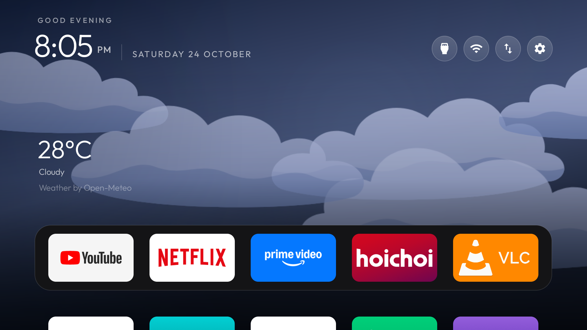
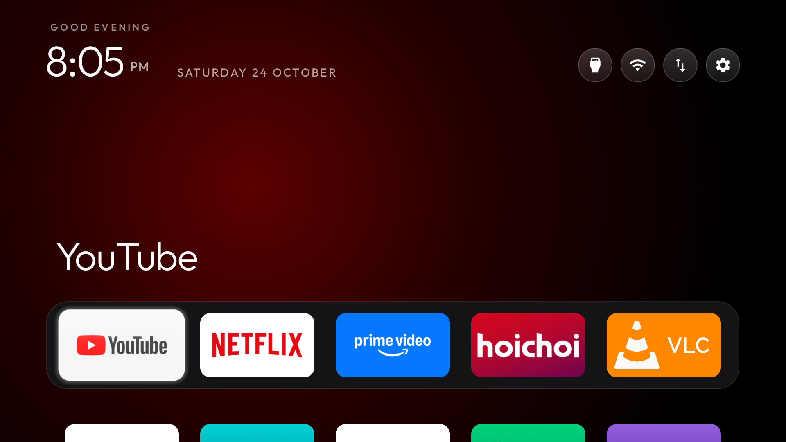
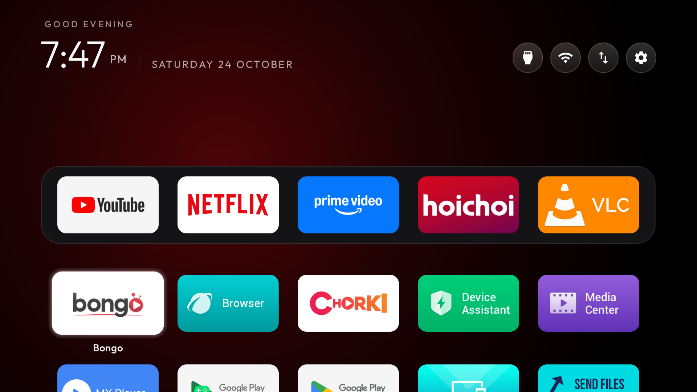
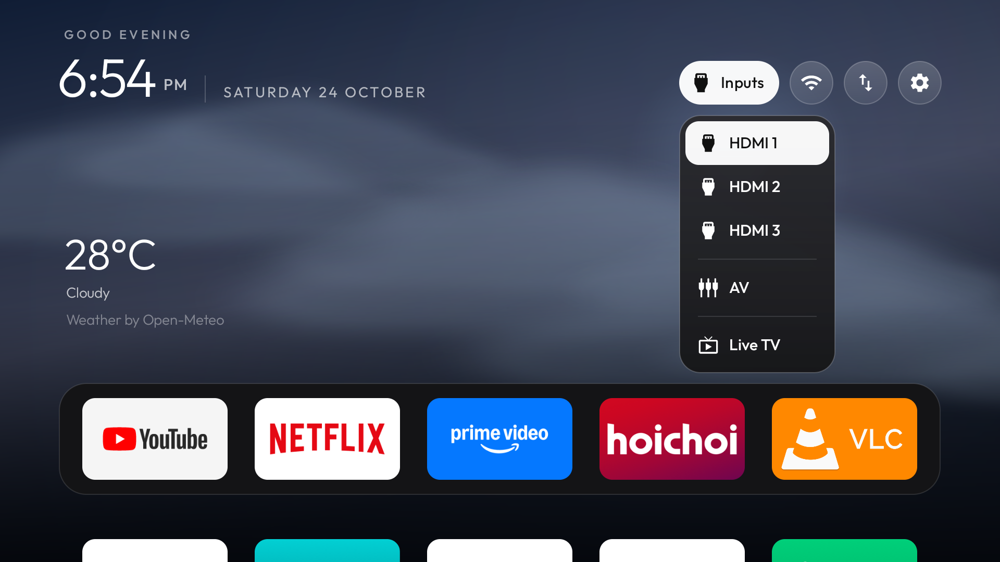

# Atmosphere TV

A weather-first Android TV home screen with painted clouds, gentle motion, and a clean five-app dock.

**An independent fork of [Gathin23/cleanyourtv](https://github.com/Gathin23/cleanyourtv).** The original launcher, tools, MIT license, and [Outfit](https://fonts.google.com/specimen/Outfit) typeface are credited below. Atmosphere TV adds a different Home experience and online weather; it is maintained separately from the upstream reference launcher.

## What it does

- **Weather when Home is idle.** Painted clouds drift in layers, rain falls in streaks, snowflakes float and rotate, and sunlight gently changes in intensity. Conditions follow the current location.
- **An app gets its own atmosphere.** Focus a tile to blend into the color sampled from its banner. Home and Back from the app grid return to weather with nothing selected.
- **A quiet top bar.** Inputs, Wi-Fi, Rearrange, and Settings stay as icons until focused; each label expands beside its icon.
- **A dock you can rearrange.** Five slots by default: YouTube, Netflix, Prime Video, Hoichoi, VLC. Change apps, columns, and order to suit your TV.
- **Native TV controls.** D-pad navigation, an app grid, HDMI/AV/Live TV switching, and optional remote-key helpers inherited from cleanyourtv.

The scene is drawn with native Canvas gradients and small cached textures. There are no video wallpapers or full-screen blur passes. Drawing pauses behind apps; the animation is limited to roughly 30 fps while visible. Online weather refreshes about every 30 minutes while Home is visible, rather than running a background service.

## Screenshots from a real TV

| Weather landing | Focused app |
|---|---|
|  |  |
| **App grid** | **Inputs and inline labels** |
|  |  |

Captured on a Hisense SmartTV 4K FFM, Android 11. The Inputs screenshot predates the final weather artwork; the menu behavior is the same. App logos belong to their respective owners and are shown as installed shortcuts. No streaming app or content is bundled.

## Build and install

Requires Android 8.0 / API 26 or newer. The build uses SDK platform 34, build-tools 34.0.0, and Gradle 8.9. JDK 18 was used for the verified build; JDK 17 also fits this toolchain.

1. Follow [the installation guide](docs/INSTALL.md) to build and sideload the APK while leaving stock Home available.
2. Use the TV to verify Home, remote buttons, inputs, playback, and recovery before considering any stock-launcher changes.
3. See [customization](docs/CUSTOMIZATION.md) for the dock, theme, and remote mapping.

This repository retains the upstream application ID, `com.gathin.tvhome`, and installs with the label **Home**. It cannot coexist with another build using that same ID. Updates must use the same signing key. Keep your own signing key private; no signing key is included here.

Debloating is separate from the launcher. For model-specific discovery and reversible cleanup, use [cleanyourtv's original guidance](https://github.com/Gathin23/cleanyourtv). This repository does not publish a universal disable list or the private backup of the TV used for development.

## Weather and privacy

Weather uses the TV's recent Android location when permission and a location provider are available. Otherwise it uses an approximate public-IP location from **ipwho.is**, then requests conditions from **Open-Meteo**. An ISP or VPN can make that location inaccurate.

Only the latest temperature, condition, day/night flag, and update time are cached privately. Coordinates, IP, city, and location history are not saved by this weather feature. Fresh cached weather can return after a restart; data older than 90 minutes is hidden. Weather is hidden without validated internet access, leaving the existing launcher background.

Default weather network services, retry behavior, and limitations are documented in [PRIVACY.md](docs/PRIVACY.md). This fork has built-in online weather, unlike the upstream launcher's no-network design. No Google account or weather API key is required. Open-Meteo's public endpoint has [noncommercial-use terms and limits](https://open-meteo.com/en/pricing); obtain appropriate service access before distributing a commercial product.

## Tested hardware and known limitations

| Item | Result |
|---|---|
| TV | Hisense SmartTV 4K FFM, device family `songshan` |
| OS / firmware | Android 11 / API 30, `RTT2.220118.001` |
| Build checks | 232 unit tests passed; no lint errors; 82 lint warnings |
| Home / Back / app grid | Verified with D-pad input and TV screenshots |
| Rearranging | Move/save verified; requested dock order restored afterward |
| Restart | Default Home, weather recovery, package states, and helper binding checked |
| Real remote and playback | TV-icon, Apps, Input, YouTube playback and return Home confirmed on the TV |

**Remote-helper tradeoff:** on this firmware, binding the accessibility key helper makes held Volume Up/Down behave as single steps. Repeated taps work. The user chose the TV shortcut over held-volume repeat. Leave the helper disabled if held repeat matters more, and test your own remote before relying on a mapping. Other TV models have not been verified.

An earlier YouTube-to-VLC crash report could not be reproduced; its cause remains unconfirmed. Subsequent app transitions returned to Home without a launcher crash entry. The test results above are compatibility observations, not a long-term reliability or performance benchmark.

## Contributing

Bug reports should include the TV model, Android/firmware version, reproduction steps, and a screenshot without personal information. See [CONTRIBUTING.md](CONTRIBUTING.md).

For upstream cleanyourtv, this project belongs in **SHOWCASE.md → Forks of the launcher**, because it changes the launcher and adds network weather. The listing was submitted in [cleanyourtv PR #1439](https://github.com/Gathin23/cleanyourtv/pull/1439); see [submission details](docs/UPSTREAM_SHOWCASE.md). Submission does not imply acceptance or endorsement by upstream.

## Credits and license

- **Gathin and cleanyourtv contributors** — original launcher and tools, [base commit](https://github.com/Gathin23/cleanyourtv/tree/c965ef4b11acc0ab34d6964f1dda745904111a46). Their MIT copyright notice is retained in [LICENSE](LICENSE).
- **Outfit** — font files in `launcher/app/src/main/res/font/`; [SIL Open Font License](launcher/FONT-LICENSE-OFL.txt).
- **Open-Meteo** — current weather; attribution is displayed on Home.
- **ipwho.is** — approximate location fallback.

Source code is distributed under the included MIT license. Bundled fonts retain their own license. App and platform names and logos remain the property of their respective owners. This is not an official Hisense, Google, Apple, or cleanyourtv release.
